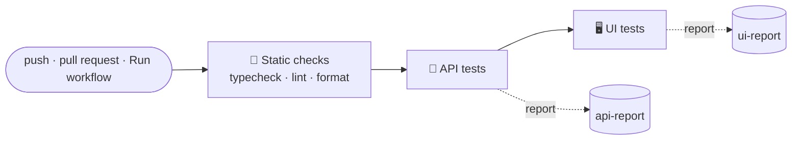
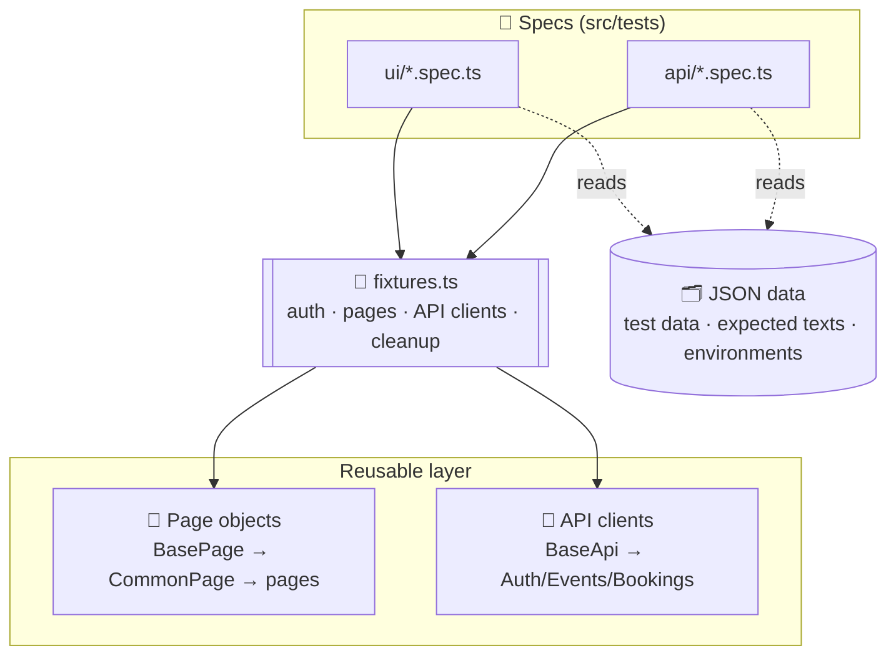
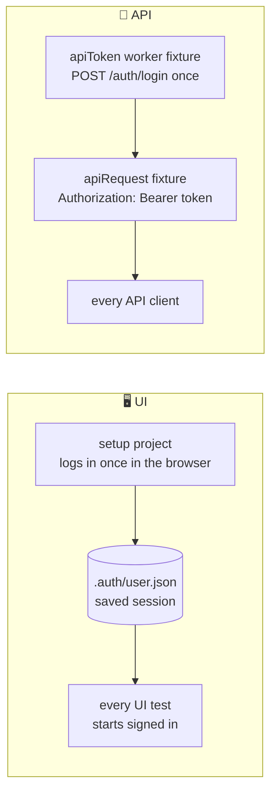
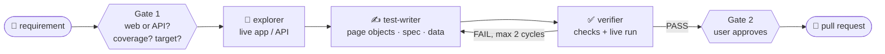

<div align="center">

# 🎟️ EventHub QA Automation

**UI + API test automation for US-114 "Book tickets for an event"**

[](https://github.com/5000hussein/siemens-qa-assessment/actions)


[Web app](https://eventhub.rahulshettyacademy.com) · [API docs (Swagger)](https://api.eventhub.rahulshettyacademy.com/api/docs) · [CI runs](https://github.com/5000hussein/siemens-qa-assessment/actions)

</div>

---

**EventHub** is a ticket-booking platform. A signed-in user browses events, books 1–10 tickets by entering their name, email and phone, gets a booking reference, sees the booking under **My Bookings**, and can cancel it. Everything the web UI does is also available through a REST API.

|        🧪 Tests         |       🖥️ UI       |       🔌 API        |     🐞 Defects found      |       ⏱️ Runtime        |
| :--------------------: | :--------------: | :----------------: | :----------------------: | :--------------------: |
| **25** (incl. 1 setup) | **6** end-to-end | **18** (2 defects) | **7** app vs story/docs  | **~45 s** on one worker |

## 📑 Contents

| #   | Section                                                         | What you'll find                                         |
| --- | --------------------------------------------------------------- | -------------------------------------------------------- |
| 1   | [🚀 How to run](#how-to-run)                                    | Setup, commands, CI                                      |
| 2   | [🔍 Story review](#story-review)                                | Questions for the PO, app vs story/docs, assumptions     |
| 3   | [🎯 What is tested and why](#what-is-tested)                    | Coverage per acceptance criterion and the reasoning      |
| 4   | [🧭 Key decisions](#key-decisions)                              | Architecture choices and why                             |
| 5   | [🔮 What I'd do with more time](#more-time)                     | AI tooling, coverage, scale, secrets                     |
| 6   | [📘 Framework guide](#framework-guide)                          | Layout, how it works, rules, configuration, AI tooling   |

---

<a id="how-to-run"></a>

## 🚀 1. How to run

> [!IMPORTANT]
> **Prerequisites:** Node.js 20+. As the submission brief asks, the repository includes a `.env` with a dedicated, throwaway EventHub test account, so the tests run straight after cloning.

```bash
npm ci
npx playwright install chromium
npm test                      # setup + UI + API: 25 tests, about 45 s
```

| Command                                                     | What it does                                                        |
| ----------------------------------------------------------- | ------------------------------------------------------------------- |
| `npm run test:ui`                                           | UI tests (the `setup` project signs in first)                       |
| `npm run test:api`                                          | API tests only, no browser                                          |
| `npx playwright test <file>`                                | One spec file                                                       |
| `npm run test:debug`                                        | Step through a test in the Playwright Inspector                     |
| `npm run test:report`                                       | Open the HTML report (screenshot, video and trace for each failure) |
| `HEADLESS=true npm test`                                    | Hide the browser locally (visible by default, always hidden in CI)  |
| `SLOW_MO=500 npm run test:ui`                               | Slow every action by 500 ms to watch the run                        |
| `npm run typecheck && npm run lint && npm run format:check` | Static checks                                                       |
| `npm run api:spec`                                          | Re-download the API spec into `.claude/domain/openapi.json`         |

> [!TIP]
> **Using your own account:** the tests book the event named in `src/data/test_data/bookings.json` (`eventName`, currently "Hollywood Monsoon Night — Los Angeles"). If your account doesn't have an event with that title, put one of your own event titles there.

The environment is public and shared, so every test cancels the bookings it creates, even when it fails.

### ⚙️ Continuous integration (GitHub Actions)

`.github/workflows/EventHub QA - UI & API Tests.yml` runs on every push, on every pull request, and from the **Run workflow** button in the Actions tab.



- **UI tests run after the API job**, even when the API tests fail. They don't run in parallel with it because both book the same event on the same account, and the seat-count checks would read each other's bookings.
- Each test job uploads its HTML report as an artifact. Failures also appear as **annotations** on the run page.
- In CI the browser is headless, a failed test is retried once, and a forgotten `test.only` fails the run.

**Run workflow** (Actions tab → EventHub QA - UI & API Tests → Run workflow) has two options. Push and pull-request runs always use the defaults.

| Option        | Choices            | Default |
| ------------- | ------------------ | ------- |
| `environment` | `PROD`             | `PROD`  |
| `suite`       | `all`, `api`, `ui` | `all`   |
| `retries`     | `0`, `1`, `2`, `3` | `1`     |

> [!NOTE]
> **One-time setup:** in the repository on GitHub, open **Settings → Secrets and variables → Actions** and add `EVENTHUB_USER_EMAIL` and `EVENTHUB_USER_PASSWORD`. If one is missing, the job stops straight away and names it.

---

<a id="story-review"></a>

## 🔍 2. Story review

> **US-114:** As a visitor to EventHub, I want to book tickets for an event, so that I can attend it.
>
> - **AC1:** When I choose the number of tickets, enter my name, email and phone, and click Confirm Booking, my booking is created and I see a confirmation with a booking reference.
> - **AC2:** The total price is the ticket price multiplied by the number of tickets.
> - **AC3:** The booking appears in My Bookings.
> - **AC4:** I can cancel a booking.
> - **AC5:** The same works through the API using `POST /api/bookings`.

### ❓ What is missing or unclear: questions for the Product Owner

| #   | Area             | Question                                                                                                                                                                                                                       |
| --- | ---------------- | ------------------------------------------------------------------------------------------------------------------------------------------------------------------------------------------------------------------------------ |
| Q1  | Actor            | The story says "As a **visitor**", but booking requires a signed-in account. Is guest checkout intended, or should the story say "registered user"?                                                                            |
| Q2  | AC1 inputs       | What are the field rules? The app enforces name ≥ 2 characters, a valid email, and a "10-digit" phone (UI) but only ≥ 10 characters (API). Which is correct, and are international formats allowed?                            |
| Q3  | AC1 quantity     | The app limits a booking to 1–10 tickets. Is 10 the business rule? Per booking, per user or per event?                                                                                                                         |
| Q4  | AC1 availability | What happens when an event has fewer seats than requested, or is sold out? Should the UI cap the counter at the available seats?                                                                                               |
| Q5  | AC1 reference    | What is the booking-reference format, and is it guaranteed unique? (See D1.) Is a confirmation email expected?                                                                                                                 |
| Q6  | AC2 price        | Which currency? Any taxes, booking fees, discounts or rounding? Should the total be shown before confirming? (It is.)                                                                                                          |
| Q7  | AC3 My Bookings  | Which fields must be shown, in what order, with what pagination? Should cancelled bookings still appear, marked "cancelled"?                                                                                                   |
| Q8  | AC4 cancel       | Who can cancel, and until when (the event date? a cut-off)? Are refunds part of this story? (There is a "Check eligibility for refund?" button.) Are seats released? Should cancelling need confirmation? (There is a dialog.) |
| Q9  | AC4 outcome      | Should a cancelled booking be **deleted** or **marked cancelled**? (See D3.)                                                                                                                                                   |
| Q10 | AC5 API          | What is the response contract, which errors are expected (400/401/404/409), and must the API apply the same rules as the UI?                                                                                                   |
| Q11 | Events           | Can past events be booked? (See D5.)                                                                                                                                                                                           |
| Q12 | Non-functional   | Concurrency (two users taking the last seats), accessibility, mobile and performance targets?                                                                                                                                  |

### 🐞 Where the application differs from the story or the docs

| #   | Observation                                                                                                                                                                                                              | Where           | Evidence in this repo                                                                                  |
| --- | ------------------------------------------------------------------------------------------------------------------------------------------------------------------------------------------------------------------------ | --------------- | ------------------------------------------------------------------------------------------------------ |
| D1  | **Booking reference format:** the docs say `EVT-XXXXXX`; the API returns the first letter of the event title plus 6 characters (`D-0VYXU6`).                                                                             | API docs vs API | `004-contract-vs-docs.spec.ts` (`test.fail`)                                                           |
| D2  | **Number types:** `totalPrice` and `price` are documented as numbers but returned as strings (`"900"`). A client that computes `price * quantity` on strings risks errors.                                               | API docs vs API | `004-contract-vs-docs.spec.ts` (`test.fail`)                                                           |
| D3  | **Cancel is a hard delete:** `DELETE /bookings/{id}` removes the record (a later `GET` returns 404), yet the schema has `status: cancelled` and the list has a `status=cancelled` filter that can never return anything. | API docs vs API | `003-cancel-booking.spec.ts`                                                                           |
| D4  | **"List all bookings"** returns only the signed-in user's bookings. The behaviour is right; the docs are wrong.                                                                                                          | API docs        | none                                                                                                   |
| D5  | **Past events are listed as "Upcoming" and can be booked:** events dated July and October 2026 appear under "Upcoming Events" and accept bookings in November 2026.                                                      | UI              | manual check                                                                                           |
| D6  | **The phone rule differs:** the UI says "Enter a valid 10-digit phone"; the API only requires `minLength 10` on a free-text string.                                                                                      | UI vs API       | manual check (the API test's invalid phone `123` breaks both rules, so it doesn't show the difference) |
| D7  | **No feedback after cancelling:** the card disappears without a message or toast.                                                                                                                                        | UI              | none                                                                                                   |

### 📝 Assumptions made to keep going

- A signed-in user counts as a "visitor".
- The observed reference format is acceptable.
- "Cancel" means the booking disappears from My Bookings and its seats are released.
- The 1–10 ticket limit is intended.

---

<a id="what-is-tested"></a>

## 🎯 3. What is tested and why

**25 tests:** 1 setup (sign-in), 6 UI, 18 API (2 of them known-defect checks).

| AC                                      | 🖥️ UI                                                                                                                      | 🔌 API                                                                                                                        |
| --------------------------------------- | -------------------------------------------------------------------------------------------------------------------------- | ----------------------------------------------------------------------------------------------------------------------------- |
| ✅ AC1 booking, confirmation, reference | Full flow from the events list, reference format checked                                                                   | 201 response shape and reference format                                                                                       |
| ✅ AC1 negative                         | Invalid name, email and phone show messages and create no booking                                                          | 400 for quantity 0 and 11, short name, bad email, short phone, empty body; 404 unknown event; 401 no token                    |
| ✅ AC2 price × quantity                 | Summary at 1, 3 and 10 tickets, plus the confirmation total                                                                | `totalPrice` for 3 and 10 tickets                                                                                             |
| ✅ AC3 in My Bookings                   | The card shows ref, event, quantity, total and status; View Details shows ref, status, event, customer and payment summary | Read back by id, by reference and from the list                                                                               |
| ✅ AC4 cancel                           | Cancel through the dialog; gone after a reload; backend returns 404; seats restored                                        | 200 then 404; seats restored; cancel twice returns 404; unknown id returns 404; no token returns 401 and the booking survives |
| ✅ AC5 via API                          | n/a                                                                                                                        | All of the above, plus available seats drop by the booked quantity                                                            |

**Why this split:**

- **UI tests** cover what only the UI can prove: the user journey, what is on screen, and the client-side validation.
- **Rules and edge cases** (limits, invalid input, auth, error codes, seat arithmetic) are cheaper and more stable through the API, so most combinations live there.
- Each AC has at least one positive UI test and one positive API test. Negative cases sit on the boundaries the app enforces: 0, 1, 10 and 11 tickets.

**🚫 Not covered, on purpose:**

- registration, which is outside US-114
- admin event management, which changes shared data
- the refund check, which is not in the ACs
- visual and cross-browser checks

---

<a id="key-decisions"></a>

## 🧭 4. Key decisions



| Decision                                                                                         | Why                                                                                                                                   |
| ------------------------------------------------------------------------------------------------ | ------------------------------------------------------------------------------------------------------------------------------------- |
| Playwright + TypeScript for both UI and API                                                      | One language, one runner, one report; the API client is built in                                                                      |
| Authorization in the framework (setup project + token worker fixture)                            | Required by the brief; no test logs in; one place to change; faster runs                                                              |
| Layers: specs → page objects / API clients → JSON data                                           | Specs read like the acceptance criteria; locators and HTTP details are written once                                                   |
| API classes only call the endpoint; specs assert on status and body                              | Same shape as page objects; every assertion is visible in the spec                                                                    |
| One fixture file, one line per page or client                                                    | Adding a screen or endpoint is a two-step recipe                                                                                      |
| Test data and expected texts in JSON, keyed by environment                                       | No literals in specs; a new environment is a new JSON block, not code                                                                 |
| Event chosen by name through `GET /events?search`                                                | Readable data; ids differ per account, so ids are never stored                                                                        |
| Independent tests that clean up in a fixture teardown                                            | Shared public environment; any order; re-runnable; nothing left behind when a test fails                                              |
| Set up through the API, verify on the layer under test                                           | Faster, less flaky; each test proves one thing                                                                                        |
| UI results cross-checked against the API                                                         | What the user sees matches what was stored                                                                                            |
| Known defects as `test.fail`                                                                     | Visible in every run without a red build; turns red the day the defect is fixed                                                       |
| One worker                                                                                       | Seat-count checks share one account and would race in parallel                                                                        |
| Built on the team's existing framework conventions (BasePage, JSON data, `TIMEOUTS`, lint rules) | Familiar to the team. Differences: framework-owned auth, credentials in `.env` instead of JSON, independent tests                     |
| A Claude Code package (`.claude/`) next to the framework                                         | New tests can be generated from a requirement and verified against the live app, following the same rules a person does (section 6.5) |

---

<a id="more-time"></a>

## 🔮 5. What I'd do with more time

### 🤖 AI tooling (`.claude/`)

1. **More AI processes with better orchestration.** Today `/automate` runs one straight line: explorer → test-writer → verifier. Next steps:
   - a **planner** agent that turns a story into a reviewed test-case list before any code is written
   - a **reviewer** agent that checks the generated code against the conventions
   - a **maintenance** flow that re-explores the live app when locators break
   - an orchestrator that runs independent steps in parallel (for example, UI and API exploration together)
2. **Higher accuracy.** Each agent returns structured JSON that is checked before the next step. The domain knowledge gets refreshed automatically from the live app and the OpenAPI spec. Every generated test must pass several live runs before it is accepted, and an evaluation set of known requirements and expected tests measures the agents over time.

### 🧪 Test coverage

3. **More UI coverage:**
   - the full booking journey across screens in one flow
   - sold-out and low-seat events
   - the cancel dialog's "keep booking" path
   - pagination in My Bookings
   - the refund-eligibility check
   - mobile viewports
4. **Schema validation** of every API response against the OpenAPI spec, to catch contract drift automatically.
5. **Concurrency:** create an event with a few seats, then race two bookings for the last one.
6. **Accessibility checks** with `@axe-core/playwright`.

### 📈 Scale

7. **One account per worker** (registered in global setup), then parallel runs. Firefox and WebKit projects, and publishing results to the team's test-management tool.

### 🔐 Secrets

8. **Encrypted credentials in the repo** with a library such as [dotenvx](https://dotenvx.com). Today `.env` is committed in plain text because the submission asks for it. With dotenvx it would be committed **encrypted**, and each machine decrypts it at run time with a private key it keeps locally (CI keeps it as one repository secret). Credentials then stay versioned with the code, a new teammate needs only the key instead of every value, and nothing readable sits in the repository.

---

<a id="framework-guide"></a>

## 📘 6. Framework guide

### 📁 6.1 Repo layout

```
src/
  core/      BasePage.ts (parent of all pages) · fixtures.ts (every fixture: auth, pages, API clients, booking cleanup)
  pages/     CommonPage → EventsPage, EventDetailsPage, MyBookingsPage, BookingDetailsPage · LoginPage
  api/       BaseApi → AuthApi, EventsApi, BookingsApi
  config/    environment.ts (env, paths, credentials) · routes.ts
  data/      environments.json · assertions.json (expected texts) · test_data/*.json
  utils/     jsonHelper.ts · timeouts.ts · format.ts
  tests/     setup/ (sign-in) · ui/<area>/ · api/<resource>/
.github/     workflows/EventHub QA - UI & API Tests.yml: CI (section 1)
.claude/     AI tooling: /automate command, agents, skills, domain knowledge, scripts (section 6.5)
```

A spec's folder decides its project: `src/tests/ui/**` runs in the `ui` project (browser, signed in), and `src/tests/api/**` in the `api` project (no browser).

### 🛠️ 6.2 How the framework works

#### 🔑 Authorization is handled by the framework, not by tests

No test contains a login step.



- **UI:** the `setup` project signs in **once** through the real login page and saves the browser state (cookies and `localStorage`, which holds the token) to `.auth/user.json`. The `ui` project depends on `setup` and loads that file, so every UI test starts signed in.
- **API:** a **worker fixture** (`apiToken`) calls `POST /auth/login` once. The `apiRequest` fixture adds `Authorization: Bearer <token>` to every request, and every API client is built on it. `anonymousBookingsApi` has no token and is used only for 401 checks.

If sign-in changes, one file changes.

#### 🔧 Fixtures

A fixture is an object Playwright creates for a test. The test names what it needs and gets it ready to use:

```ts
test('AC4: Check the user is able to cancel a booking ...', async ({ eventsApi, bookingsApi, myBookingsPage }) => { ... });
```

Each fixture is a small recipe in `src/core/fixtures.ts`:

```ts
apiRequest: async ({ apiToken }, use) => {
  const ctx = await request.newContext({
    baseURL: apiBaseUrl,
    extraHTTPHeaders: { Authorization: `Bearer ${apiToken}`, Connection: 'close' },
  });                   // setup
  await use(ctx);       // the test runs here
  await ctx.dispose();  // teardown: after the test, even if it failed
},
```

`Connection: 'close'` opens a fresh connection for every call. In CI the server drops idle connections during long UI steps, and reusing one caused "socket hang up" errors.

|                      | Test fixture (default)                                              | Worker fixture (`{ scope: 'worker' }`)                 |
| -------------------- | ------------------------------------------------------------------- | ------------------------------------------------------ |
| Created              | before **each** test                                                | **once** per worker                                    |
| Shared between tests | no                                                                  | yes                                                    |
| Used for             | pages, API clients, the HTTP client: anything that must start clean | `apiToken`: expensive to get, read-only, safe to share |

#### 📄 Page objects

- `BasePage` holds the browser tab and small helpers (`navigateTo`, `click`, `typeText`).
- `CommonPage` adds the header shared by every signed-in screen.
- Each screen has one class that holds its **locators** (how to find elements) and its **actions and checks** (`openEvent`, `cancelBooking`, `verifyPaymentSummary`).
- Specs never use raw locators; they call page methods.

#### 🔌 API clients

One class per topic, like the pages: `AuthApi`, `EventsApi`, `BookingsApi`. Each method calls **one endpoint and returns the response**, nothing else:

```ts
async createBooking(data: object): Promise<APIResponse> {
  return this.request.post('bookings', { data });
}
```

The spec sends the request and asserts on the response:

```ts
// Get the event by name
const eventsResponse = await eventsApi.getEvents({ search: eventName });
expect(eventsResponse.status()).toBe(200);
const event = (await eventsResponse.json()).data[0];

// Create the booking
const response = await bookingsApi.createBooking({ ...createBookingBody, eventId: event.id });
expect(response.status()).toBe(201);
```

`{ ...createBookingBody, eventId: event.id }` copies the request body from the JSON and adds the event id, which is only known at runtime.

#### 🧹 Cleanup

The environment is shared and public, so nothing a test creates may be left behind, even when the test fails. Tests that create a booking request the `bookingCleanup` fixture and register the id as soon as it exists:

```ts
const booking = (await createResponse.json()).data;
bookingCleanup.track(booking.id);
```

The fixture's teardown runs after the test, pass or fail, and cancels every tracked booking. A 404 means the test already cancelled it itself. A booking made through the UI is looked up by its reference (`getBookingByRef`) right after the confirmation and tracked the same way.

#### 🗂️ Test data and expected texts

- **Inputs** live in `src/data/test_data/*.json`, keyed by environment (`PROD`). Single values are read with `readJsonValue`, and whole objects such as request bodies with `readJsonObject`.
- **The event is chosen by name** (`eventName`). Each test calls `GET /events?search=<name>`, asserts 200, and asserts that the first result's title is that name. The search is fuzzy, so this check makes a missing or different event fail with a clear message.
- **Expected texts** (messages, dialog titles, statuses, patterns) live in `src/data/assertions.json` and are imported directly.
- **The environment** is chosen with `ENV` (default `PROD`). A new environment needs a new block in `environments.json` and the test data files, not code.

#### ⏳ Waiting and timeouts

Every browser or HTTP action is asynchronous, so each step is `await`ed, and a lint rule catches any missing `await`. Playwright **auto-waits** before every click or fill, and `expect(...)` retries until it passes, so there are no fixed sleeps.

| Limit                            | Value         | Applies to                                 |
| -------------------------------- | ------------- | ------------------------------------------ |
| `timeout`                        | 60 s          | a whole test (the longest takes about 7 s) |
| `expect.timeout`                 | 10 s          | each single assertion                      |
| `TIMEOUTS.short / medium / long` | 5 / 15 / 30 s | individual waits inside page objects       |

#### 🐞 Known defects are tests

When the app contradicts its documentation, the documented behaviour is still asserted, inside `test.fail(true, '<expected X, actual Y>')`. The run stays green while the defect exists and turns red the day it is fixed, which is the signal to remove the marker. See `src/tests/api/bookings/004-contract-vs-docs.spec.ts`.

### 📏 6.3 Repo rules and conventions

#### Rules

1. **Tests never log in.** Auth comes from the framework.
2. **No literals in specs.** Data comes from `src/data/**/*.json`, expected texts from `assertions.json`, routes from `routes.ts`, timeouts from `TIMEOUTS`.
3. **Specs have no helper functions or computed values.** Computation lives in the page objects' `verify*` methods.
4. **Every test owns its data:** it creates what it needs, never pins ids, and tracks every booking for cleanup. Never use "Clear all bookings".
5. **Locator priority:** role and name → test id → label or text → `#id` → XPath. Each locator matches exactly one element, scoped to a parent when text repeats.
6. **No static waits** (`waitForTimeout` fails lint).
7. **Never weaken an assertion** to make a run pass. A real mismatch becomes `test.fail` plus a row in the story review (section 2).
8. **No secrets in code.** Credentials live only in `.env` (committed here with a throwaway test account, as the submission asks). `.auth/` (the saved session) is git-ignored.
9. **Green before commit:** typecheck, lint, format check, and the affected tests pass.

<details>
<summary><b>🏷️ Naming conventions</b></summary>

<br/>

| Style                                      | Used for                                           | Examples                                                            |
| ------------------------------------------ | -------------------------------------------------- | ------------------------------------------------------------------- |
| **PascalCase**                             | classes and types                                  | `LoginPage`, `BookingsApi`, `Fixtures`                              |
| **camelCase**                              | variables, functions, methods, fixtures, JSON keys | `loginPage`, `bookingsApi`, `verifySignedInAs()`, `successMessages` |
| **UPPER_CASE**                             | shared constants                                   | `ROUTES`, `TIMEOUTS`                                                |
| File named after its class (PascalCase)    | one class per file                                 | `LoginPage.ts`, `BookingsApi.ts`                                    |
| camelCase file                             | helpers, config, data, fixtures (no class)         | `fixtures.ts`, `jsonHelper.ts`, `assertions.json`                   |
| kebab-case `NNN-<what>.spec.ts`            | test files (`NNN` groups by theme, not run order)  | `001-book-tickets.spec.ts`                                          |
| `Check the user is (not) able to <action>` | test titles, AC prefix when there is one           | `AC4: Check the user is able to cancel a booking from My Bookings…` |

The class `LoginPage` is the blueprint; the fixture `loginPage` is the object built from it (`new LoginPage(page)`).

</details>

<details>
<summary><b>➕ Adding a screen, an endpoint or a test</b></summary>

<br/>

| To add      | Do this                                                                                                                                                                                         |
| ----------- | ----------------------------------------------------------------------------------------------------------------------------------------------------------------------------------------------- |
| A screen    | Create `src/pages/XPage.ts` extending `CommonPage` (or `BasePage` if signed-out), then add one fixture line in `fixtures.ts`: `xPage: async ({ page }, use) => { await use(new XPage(page)); }` |
| An endpoint | Add methods to the matching client in `src/api/`, or a new `XApi extends BaseApi` plus one fixture line                                                                                         |
| A test      | Put data in JSON and texts in `assertions.json`, then write `src/tests/ui/<area>/NNN-<flow>.spec.ts` or `src/tests/api/<resource>/NNN-<behaviour>.spec.ts`                                      |

</details>

### ⚙️ 6.4 Configuration explained

<details>
<summary><b><code>playwright.config.ts</code></b></summary>

<br/>

| Key                              | Value                     | Why                                                                                         |
| -------------------------------- | ------------------------- | ------------------------------------------------------------------------------------------- |
| `testDir`                        | `./src/tests`             | Where tests live                                                                            |
| `timeout` / `expect.timeout`     | 60 s / 10 s               | Per test / per assertion                                                                    |
| `fullyParallel`, `workers`       | `false`, `1`              | One test at a time (section 4)                                                              |
| `forbidOnly`                     | `true` in CI              | A forgotten `test.only` fails the CI run instead of silently skipping the rest              |
| `retries`                        | 1 in CI, 0 locally        | Absorbs network blips on a public environment; the report still marks the test "flaky"      |
| `reporter`                       | `list` + `html` (+ `github` in CI) | One line per test, a full HTML report, and in CI each failure as an annotation on the run page |
| `use.baseURL`                    | from `environments.json`  | Pages navigate with short paths (`/bookings`)                                               |
| `use.trace / screenshot / video` | kept on failure only      | Evidence for failures; fast passing runs                                                    |
| `use.headless`, `slowMo`         | `HEADLESS`, `SLOW_MO`     | Visible browser locally, hidden in CI                                                       |
| `projects`                       | `setup` → `ui`, and `api` | `setup` signs in once; `ui` depends on it and loads the saved login; `api` needs no browser |

</details>

<details>
<summary><b><code>tsconfig.json</code></b></summary>

<br/>

Used only for checking (`npm run typecheck`). Playwright runs TypeScript directly, with no build step.

| Key                                | Why                                                                                  |
| ---------------------------------- | ------------------------------------------------------------------------------------ |
| `strict: true`                     | Full type safety: null handling, no hidden `any`                                     |
| `target` / `lib`                   | Modern JavaScript (ES2020) plus browser types (`dom`) for code that runs in the page |
| `module` / `moduleResolution`      | Node-style modules and imports                                                       |
| `esModuleInterop`                  | Plain `import x from 'pkg'` works for every package                                  |
| `resolveJsonModule`                | Lets `assertions.json` be imported with types                                        |
| `skipLibCheck`                     | Doesn't type-check `node_modules` (faster)                                           |
| `forceConsistentCasingInFileNames` | Import case must match the file name, which Linux CI requires                        |
| `include: src/**/*`                | Only framework code is checked                                                       |

</details>

<details>
<summary><b>Other files</b></summary>

<br/>

| File                                                 | Purpose                                                                                                            |
| ---------------------------------------------------- | ------------------------------------------------------------------------------------------------------------------ |
| `eslint.config.mjs`                                  | TypeScript rules plus Playwright rules: no missing `await`, no `waitForTimeout`, no `test.only`, no `page.pause()` |
| `.prettierrc.json`                                   | Formatting: single quotes, 140-character lines                                                                     |
| `package.json`                                       | Scripts (section 1) and dev dependencies; Node 20+                                                                 |
| `.env.example`                                       | Template for `.env`: only the two credentials                                                                      |
| `.gitignore`                                         | Keeps the saved session (`.auth/`) and generated output out of git                                                 |
| `.mcp.json`                                          | AI tooling only (section 6.5); the test suite doesn't use it                                                       |
| `.github/workflows/EventHub QA - UI & API Tests.yml` | CI: static checks → API tests → UI tests, reports as artifacts (section 1)                                         |

</details>

### 🤖 6.5 AI tooling (`.claude/`)

The repo ships a small Claude Code package. The test suite runs without it.



| Part                                   | What it does                                                                                                                                                      |
| -------------------------------------- | ----------------------------------------------------------------------------------------------------------------------------------------------------------------- |
| `CLAUDE.md` (repo root)                | Always-on rules for any AI agent working in the repo, and a map of the package                                                                                    |
| `commands/automate.md`                 | `/automate <requirement or flow>`: turns a requirement into a verified test and a PR (flow above)                                                                 |
| `agents/automate/explorer` (Opus)      | Read-only. Web: walks the steps in a live, signed-in Chrome through the Playwright MCP and returns verified locators. API: makes live calls and records responses |
| `agents/automate/test-writer` (Opus)   | Writes page objects or API clients, the spec and its JSON data, and registers fixtures                                                                            |
| `agents/automate/verifier` (Sonnet)    | Runs typecheck, lint and format, checks step coverage and conventions, runs the tests live; reports PASS or FAIL, never edits                                     |
| `skills/framework-conventions`         | Where files go and how code is written in this repo; loaded by every agent                                                                                        |
| `skills/locator-rules`                 | Locator priority, uniqueness and scoping                                                                                                                          |
| `skills/test-fix` (`/test-fix <spec>`) | Finds the root cause of a failing test and fixes the framework code without weakening the assertion                                                               |
| `domain/`                              | Facts about the app: requirements, screen map, API notes, `openapi.json`, known issues. Rules live in skills; facts live here                                     |
| `scripts/fetch-api-spec.js`            | `npm run api:spec`: refreshes `domain/openapi.json` from the live Swagger docs                                                                                    |
| `settings.json`                        | Allows the Playwright MCP and test commands; denies reading `.env` and `.auth/`                                                                                   |
| `.mcp.json` (repo root)                | `playwright-test`: Chrome, starts signed in from the saved login. `github`: opens the PR; reads `GITHUB_PERSONAL_ACCESS_TOKEN` from the environment               |

---

<div align="center">

Built with 🎭 Playwright · 🟦 TypeScript · 🤖 Claude Code

</div>
